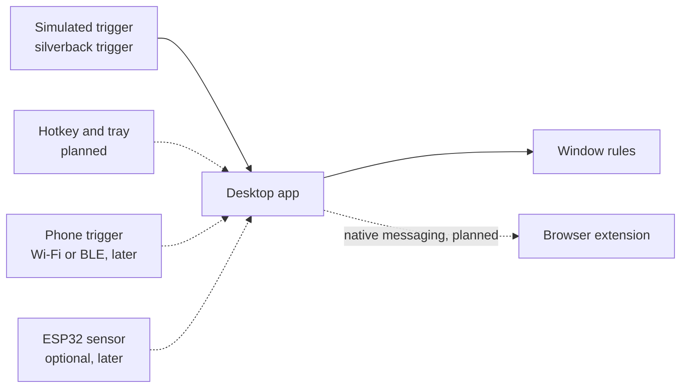

# Silver Back

Silver Back is a desk privacy guard you can build and run with no hardware. When a trigger fires, the desktop app runs a list of rules you wrote: minimize a chosen app today, and (in the next phases) hide it, close it, switch to a safe app, or put things back. A browser extension can switch or close chosen tabs.

The trigger today is a command, `silverback trigger`. You can develop, demo, and test the whole action path with that command and a sample event log. A hotkey, a tray or menu-bar control, a settings window, and installers are the next software work. An optional phone message over Wi-Fi or BLE, and an optional ESP32 sensor, come after that.

The name is the silverback: a gorilla that keeps watch.

Maintained by Wesley Siebenthal. What actually runs is in [Current status](#current-status). The plan is [ROADMAP.md](ROADMAP.md).

## Quick start

Python 3.11 or newer. From a clone of this repo:

```bash
python3 -m venv .venv
source .venv/bin/activate
python -m pip install -e "./desktop[dev]"
python -m silverback trigger --config desktop/silverback.config.example.json --dry-run
```

```text
simulated approach
[ok] minimize 'SilverBack Demo': dry-run: not executed
```

`--dry-run` prints the rule and does not touch windows. Drop the flag to run it. The example rule minimizes a window whose title contains `SilverBack Demo`.

On X11, with `xdotool` and `xmessage`:

```bash
make demo
```

```text
simulated approach
[ok] minimize 'SilverBack Demo': minimized 1 window(s): SilverBack Demo
```

That window's `_NET_WM_STATE` includes `_NET_WM_STATE_HIDDEN`. The same check is `desktop/tests/test_x11_minimize.py` when `DISPLAY` is set.

Replay a recorded session through the same parser and rules. The second approach arrives immediately, so the 2000 ms debounce drops it. Debounce uses the computer's clock, not `uptime_ms` in the file:

```bash
python -m silverback listen --stdin --dry-run \
  --config desktop/silverback.config.example.json \
  < docs/examples/session.ndjson
```

```text
hello fw=0.1.0 transport=usb-serial
approach
[ok] minimize 'SilverBack Demo': dry-run: not executed
approach suppressed by debounce
heartbeat
clear received; restoring windows is not implemented yet
```

That is the loop to build against: a trigger in, a rule out. No board, and no camera.

`python -m silverback doctor` prints the platform, whether `xdotool` is on `PATH`, and which config it opened.

## What it does

1. You write rules in a JSON file: which window titles to match, and what to do.
2. `silverback trigger` synthesizes an approach and runs the enabled rules. `silverback listen --stdin` plays a log of the same events.
3. Minimize is implemented (verified on Linux X11; the macOS and Windows backends are in the tree and were not run here). Hide, close, focus, and restore are named and reported as stubs.
4. The extension can switch or close matching tabs when something inside the browser sends a test message. The desktop app does not send that message yet.



## Who it is for

People who work at a desk, in a cubicle, or in a shared lab and want chosen apps and tabs off the screen when they say so. The simulated trigger is how you build that on a laptop with nothing else plugged in. A physical sensor is a later option for when a board is actually on the desk.

## Limits

A trigger is an event you send. Silver Back has no camera path: it does not open a webcam, take photos, record video, or detect people in images. It does not collect other people's personal data.

Hiding a window is a convenience. Someone already at the desk can still read the screen. Silver Back does not lock the session, and it does not stop screen recording or a network attack.

## Architecture

| Piece | Role today | Where |
| --- | --- | --- |
| Simulated trigger | Run the rules with no sensor | `silverback trigger` |
| Event log | Replay `hello`, `presence`, and `heartbeat` lines | `silverback listen --stdin`, `docs/examples/session.ndjson` |
| Desktop app | Parse events, debounce approaches, minimize matching window titles | `desktop/` |
| Rules file | The managed list, edited by hand until the settings UI exists | `desktop/silverback.config.example.json` |
| Browser extension | Switch or close tabs when an in-browser test message arrives | `extension/` |
| Event protocol | Version-1 JSON shared by the trigger, the log, and the optional sketch | `docs/protocol.md` |
| ESP32 sketch | Optional later. USB-serial PIR events. Not required to build or test | `firmware/` |

## Tech stack

| Part | Choice | Why |
| --- | --- | --- |
| Desktop | Python 3.11+, pyserial | One process for the trigger, the log replay, and a future serial port. Tests run with no display. |
| Linux windows | `xdotool` on X11 | Verified here. A Wayland backend is later software work. |
| macOS windows | `osascript` and System Events | Minimize by window title. Needs Accessibility permission. Not run in this environment. |
| Windows windows | `ShowWindow(SW_MINIMIZE)` via `ctypes` | No extra Python package. Checked by hand on Windows 11. No automated Windows test yet. |
| Extension | Manifest V3, no bundler | Chrome and Firefox. Tab decisions are a plain module with node tests. |
| CI | GitHub Actions | Desktop pytest on Python 3.12, extension tests on Node 22. No hardware. |
| Optional firmware | ESP32, Arduino, PlatformIO | Kept for a later phase. See [Hardware](#hardware-optional-later). |

## Repository layout

```
desktop/      Python package, example rules, pytest
extension/    MV3 extension, unpacked as-is
docs/         Protocol spec and a sample event log
firmware/     Optional later ESP32 sketch. Not part of the quick start
ROADMAP.md    Software phases first, hardware optional after that
```

## Current status

| Capability | State |
| --- | --- |
| Simulated trigger (`silverback trigger`) | Working, including a live X11 minimize test when a display is available. |
| Event log replay (`listen --stdin`) | Working. Same parser, debounce, and rules as a live event stream. |
| Rules file, parser, approach debounce | Working. Unit-tested. |
| Minimize on Linux X11 | Working via `xdotool`. |
| Minimize on macOS and Windows | Implemented, not executed in this environment. |
| Hide, close, focus a safe app | Stub. The CLI prints `[stub]` and leaves the system alone. |
| Restore on `clear` | Stub. The CLI says restore is not implemented. |
| Settings UI, hotkey, tray or menu bar | Planned. No code. |
| Extension tab switch and close | Policy is unit-tested. The popup can send a test trigger. The desktop app does not drive it yet. |
| Native messaging | Planned. No host program is installed by this repo. |
| Installers | Planned. Install today is a venv and `pip install -e`. |
| Privacy and security phases (overlay, lock, profiles, pairing, and the rest) | Planned. Phases 8–18 in the roadmap. No code yet. |
| Phone trigger over Wi-Fi or BLE | Later software phase. No camera. No code yet. |
| ESP32 USB-serial sketch | Optional later. The sketch compiles with `pio run -e esp32dev` (PlatformIO `espressif32` 8.0.0). Not flashed. Not required. |
| Battery, enclosure | Optional later. No code. |

## TODO

The near-term work is software you can build and test with `silverback trigger` and `listen --stdin`. It is tracked as phases in [ROADMAP.md](ROADMAP.md):

- Hide, close, focus, and restore on macOS, Windows, and Linux (about 18 hours)
- Session rules: cooldown, quiet hours, and a replay log (about 10 hours)
- A settings UI for the rules list (about 16 hours)
- Native messaging so a trigger drives the extension (about 14 hours)
- A hotkey and a tray or menu-bar control (about 12 hours)
- Packaging and installers (about 14 hours)
- Tests and a user guide that start from the simulated trigger (about 10 hours)

That near-term block is about 94 hours.

After it, and still before any hardware, the roadmap adds privacy and security phases (about 180 hours):

- [Screen privacy actions](ROADMAP.md#phase-screen-privacy-actions): blur or dim, a decoy workspace, mute and pause media, hide notification popups (about 24 hours)
- [Auto-lock](ROADMAP.md#phase-auto-lock) if a trigger stays active, or if you walk away and do not return in time (about 12 hours)
- [Secure restore](ROADMAP.md#phase-secure-restore) of windows and tabs only after a PIN, Touch ID, Windows Hello, or a hotkey (about 20 hours)
- [Profiles](ROADMAP.md#phase-profiles) for office, home, cafe, and screen-share, chosen by time of day or the current Wi-Fi name (about 14 hours)
- [Meeting guard](ROADMAP.md#phase-meeting-guard) while Zoom, Meet, or Teams is sharing the screen (about 16 hours)
- [Clipboard guard](ROADMAP.md#phase-clipboard-guard) clears the clipboard on trigger and does not keep the text (about 6 hours)
- [Browser extras](ROADMAP.md#phase-browser-extras): close private windows, hide tabs by domain, blur fields the user named (about 16 hours)
- [Tamper resistance](ROADMAP.md#phase-tamper-resistance): encrypted and signed rules, and a local alert if the app quits or the rules change (about 18 hours)
- [Local-only log and stats](ROADMAP.md#phase-local-event-log), with no images and no personal data (about 10 hours)
- [Secure pairing](ROADMAP.md#phase-secure-pairing) so a nearby device cannot forge or replay a trigger (about 20 hours)
- [Quality](ROADMAP.md#phase-quality): cross-platform tests, signed installers, signed auto-update, and accessible UI (about 24 hours)

A phone can send the same events over Wi-Fi or BLE (about 14 hours), still with no camera. The ESP32, the battery path, and the enclosure are a separate **Hardware (optional)** group (about 36 hours), for when a board is on the desk.

Remaining work in the roadmap is about **324 hours**. About 288 hours of that is software. The estimates live on each phase in [ROADMAP.md](ROADMAP.md). Draft GitHub issues for the eleven privacy and security phases are in [docs/issues/](docs/issues/).

## Protocol

Version 1 is one JSON object per line. `silverback trigger` synthesizes an approach. `listen --stdin` reads a file of the same lines. The optional sketch emits them on USB serial. Fields, debounce, and the browser message: [docs/protocol.md](docs/protocol.md). Sample log: [docs/examples/session.ndjson](docs/examples/session.ndjson).

```json
{"v":1,"type":"presence","state":"approach","sensor":"pir","transport":"usb-serial","fw":"0.1.0","seq":1,"uptime_ms":800}
```

## Rules file

[desktop/silverback.config.example.json](desktop/silverback.config.example.json) is the rules list:

```json
{
  "version": 1,
  "debounce_ms": 2000,
  "serial": { "port": null, "baud": 115200 },
  "actions": [
    { "type": "minimize", "match": "SilverBack Demo", "enabled": true }
  ]
}
```

Search order: `--config`, then `SILVERBACK_CONFIG`, then `./silverback.config.json`, then `~/.config/silverback/config.json`.

| Action `type` | Behavior |
| --- | --- |
| `minimize` | Minimize visible windows whose title contains `match` |
| `hide` | Stub |
| `close` | Stub |
| `focus` | Stub. This is the future "switch to a safe app" action |

`match` is a case-insensitive substring of the window title. A title like `Message - Slack` needs a substring that actually appears. Unknown JSON keys are kept so the file can grow. `silverback check-config` prints the parsed rules.

`serial.port` stays null unless you later attach the optional board. The quick start never opens a port.

Exit codes for `trigger`: `0` when every implemented action succeeded, `1` when one failed (no matching window is a failure), `2` when the config is unusable. `listen` keeps running if a window is missing and returns `0` on EOF or Ctrl-C.

The extension stores its own pattern list in `chrome.storage.local` until native messaging makes the desktop file the source of truth.

Nothing in this repo reads a `.env` file. There are no API keys.

## Extension

No build, and no sensor. In Chrome, load `extension/` as an unpacked extension. In Firefox 128 or newer, load `extension/manifest.json` as a temporary add-on. Open the popup and use **Send test trigger** after setting patterns. Steps are in [extension/README.md](extension/README.md).

## Hardware (optional, later)

Skip this section to build the software. The sketch in `firmware/` is the starting point for a later phase, described in [ROADMAP.md](ROADMAP.md) under **Hardware (optional)**. It is not part of the quick start. `pio run -e esp32dev` succeeds with PlatformIO `espressif32` 8.0.0. The image has not been flashed. Wiring and warmup notes for that later phase are in [firmware/README.md](firmware/README.md).

**Planned reference design.** This table is parts for that later phase. It is not a kit, and you do not need any of it to run `silverback trigger`.

ESP32 inputs are not 5 V tolerant. The electrical check is in the firmware readme, for when someone builds this.

| Qty | Part | Role | Example | Used by the current sketch |
| --- | --- | --- | --- | --- |
| 1 | ESP32 development board | USB serial MCU | ESP32-DevKitC or another ESP32-WROOM dev board | Yes. `board = esp32dev` |
| 1 | Digital PIR module | Presence, digital OUT | HC-SR501 | Yes, on GPIO 27, active HIGH |
| 1 | Data-capable USB cable | Power and the serial link | The cable that matches the board | Yes |
| 3 | Jumper wires | OUT, GND, VCC | Female-female if both ends are headers | Yes |
| 1 | Divider or level shifter | Only if OUT measures 5 V | 10 kΩ / 20 kΩ divider | Only if a meter says you need it |
| 1 | Time-of-flight module | Range-based presence | VL53L0X on I2C | No |
| 1 | 1S Li-ion or LiPo cell, protected | Battery power | Protected 18650 or a small pouch cell | No |
| 1 | Charger and power mux | Charge from USB without back-feeding | Chosen with the power design, not before | No |
| 1 | Enclosure and fasteners | Monitor, cubicle, or door-frame mount | Printable sleeve, not drawn yet | No |

```
USB host (computer)          ESP32                      HC-SR501
      |                      GPIO 27 <------------------ OUT
      | USB serial           GND ------------------------ GND
      |--------------------  5V or VIN ----------------> VCC
```

If that sensor is ever built, aim it at the entrance. The person already sitting at the desk will self-trigger a sensor that looks at them. The software phases do not depend on that placement.

## Tests

```bash
make test
```

That runs `pytest` in `desktop/` and `node --test` for the extension. CI is [.github/workflows/ci.yml](.github/workflows/ci.yml). Both run without a board.

## Contributing

See [CONTRIBUTING.md](CONTRIBUTING.md). Pick a software phase from the roadmap. Hardware phases are optional.

## License

[MIT](LICENSE). Copyright (c) 2026 Wesley Siebenthal.

## Credit

Silver Back was created by [Wesley Siebenthal](https://github.com/wsiebenthal). If you use it in a product, a fork, an experiment or a paper, please credit "Silver Back by Wesley Siebenthal" and link back to this repository. This is a request, not a license condition; the MIT license only requires keeping the copyright notice.

GitHub's "Cite this repository" button uses [CITATION.cff](CITATION.cff).

The MIT license covers the code, not the name. Please don't call a fork or a product "Silver Back" or use its logo in a way that suggests it is the official project.
