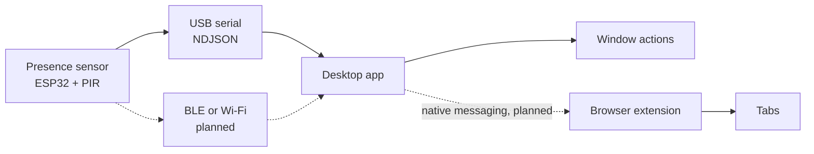

# Silver Back

Silver Back is a desk privacy guard. A small presence sensor watches the approach to a room or a cubicle. When someone comes in, a desktop companion runs a list of actions you configured: minimize chosen apps today, and (as later work) hide or close apps, focus a safe app, and ask a browser extension to switch or close chosen tabs.

The name is the silverback: a gorilla that keeps watch.

Maintained by Wesley Siebenthal. The sensor, the desktop app, and the extension are early. The [status](#current-status) table says what actually runs.

## What it does

1. An ESP32 reads a digital PIR pin, debounces it, and writes a one-line JSON event on USB serial.
2. The desktop app reads that event, or a simulated approach when you have no board, and runs the enabled actions in a JSON config.
3. A Chrome and Firefox extension can switch away from listed tabs, or close them, when it receives a trigger message. The desktop app does not send that message yet. The popup has a test button so the extension can be tried on its own.



## Who it is for

People who work at a desk, in a cubicle, or in a shared lab and want a physical cue when someone approaches, instead of remembering a hotkey. Placing the sensor is part of the project: it belongs at the entrance, aimed at the path into the space.

## Limits

Silver Back hides chosen windows after a sensor trip. A person who is already at the desk can still read the screen. It does not lock the session, stop screen recording, or do anything about network attacks. The firmware cannot tell the occupant from a visitor; that is a placement and, later, a ranging problem.

## Architecture

| Piece | Role today | Where |
| --- | --- | --- |
| Sensor firmware | Read GPIO 27, debounce 200 ms, emit `hello`, `presence`, and `heartbeat` on USB serial at 115200 | `firmware/` |
| Transport | Newline-delimited JSON, version 1 | `docs/protocol.md` |
| Desktop app | Parse events, debounce approaches, minimize matching window titles, simulate a trigger | `desktop/` |
| Browser extension | On an in-browser trigger, switch away from or close tabs that match a pattern list | `extension/` |

Wireless transport, battery power, hide/close/focus, restore on `clear`, native messaging, a settings window, and an enclosure are specified in [ROADMAP.md](ROADMAP.md) and are not in the code yet, except where the status table says **stub** (the CLI names them and refuses to pretend they ran).

## Tech stack

| Part | Choice | Why |
| --- | --- | --- |
| Firmware | ESP32, Arduino framework, PlatformIO | One sketch, USB serial, no extra libraries. The same file builds in the Arduino IDE with an ESP32 board package. |
| Desktop | Python 3.11+, pyserial | One cross-platform process, a real serial port, and tests with no display. Window control is a small backend per OS. |
| Linux windows | `xdotool` on X11 | Available on a normal X11 desktop. Wayland is future work. |
| macOS windows | `osascript` and System Events | Minimizes by window title. Needs Accessibility permission. Not run in this repo's development environment. |
| Windows windows | `ShowWindow(SW_MINIMIZE)` via `ctypes` | No extra Python package. Not run on Windows in this repo. |
| Extension | Manifest V3, no bundler | Chrome and Firefox. Tab decisions are a plain module with node tests. |
| CI | GitHub Actions | Desktop pytest on Python 3.12, extension tests on Node 22. |

## Repository layout

```
firmware/     ESP32 sketch and platformio.ini
desktop/      Python package, example config, pytest
extension/    MV3 extension, unpacked as-is
docs/         Protocol spec and a sample NDJSON session
ROADMAP.md    Phased work after this foundation
```

## Current status

| Capability | State |
| --- | --- |
| PIR pin to USB-serial JSON | Implemented in `firmware/src/main.cpp`. `pio run -e esp32dev` succeeds with PlatformIO `espressif32` 8.0.0. Not flashed on hardware here. |
| BLE, Wi-Fi, sleep, battery | Planned. No code. |
| Event parser, config file, approach debounce | Working. Unit-tested. |
| Simulated trigger (`silverback trigger`) | Working, including a live X11 minimize test when a display is available. |
| `silverback listen --stdin` | Working. Replays a recorded session through the same path as serial. |
| `silverback listen --port` | Implemented with pyserial. A missing device fails cleanly. A real board was not attached here. |
| Minimize on Linux X11 | Working via `xdotool`. |
| Minimize on macOS and Windows | Implemented, not executed in this environment. |
| Hide, close app, focus a safe app | Stub. The CLI prints `[stub]` and leaves the system alone. |
| Restore windows on `clear` | Stub. The CLI says restore is not implemented. |
| Extension tab switch and close | Policy is unit-tested. The service worker calls `chrome.tabs` when a message arrives. Not driven by the desktop app. |
| Native messaging host | Planned. No host program is installed by this repo. |
| Config UI, enclosure, releases | Planned. |

## TODO

This repository is the foundation. The rest of the product is the phased plan in [ROADMAP.md](ROADMAP.md). Next work, in the order that unblocks a desk demo:

- Flash the sketch, measure the PIR output, and keep a real captured session next to the spec
- BLE or Wi-Fi so the sensor can sit off the USB cable
- A battery path and sleep current that match a cubicle mount
- Hide, close, and focus, plus restore when the sensor sends `clear`, on each OS
- Native messaging from the desktop app into the extension
- A config window for the action list
- Hold time, occupancy, and placement notes so a passerby is less likely to trip it
- A printable enclosure and an updated bill of materials after a part has actually been built
- Tagged releases: firmware binary, desktop package, extension zip

The remaining phases are well over twenty hours of firmware, desktop, extension, mechanical, and test work. The estimates live on the phases in [ROADMAP.md](ROADMAP.md).

## Hardware bill of materials

**Planned reference design.** This table is the parts list to design and bench-test against. It is not a kit, and rows marked "no" are not used by the current sketch. Buy and wire the first four rows if you want to try the USB-serial firmware. Treat every other row as future hardware.

ESP32 inputs are not 5 V tolerant. The electrical check is in [firmware/README.md](firmware/README.md).

| Qty | Part | Role | Example | Used by the current sketch |
| --- | --- | --- | --- | --- |
| 1 | ESP32 development board | USB serial MCU | ESP32-DevKitC or another ESP32-WROOM dev board | Yes. `board = esp32dev` |
| 1 | Digital PIR module | Presence, digital OUT | HC-SR501 | Yes, on GPIO 27, active HIGH |
| 1 | Data-capable USB cable | Power and the serial link | The cable that matches the board | Yes |
| 3 | Jumper wires | OUT, GND, VCC | Female-female if both ends are headers | Yes |
| 1 | Divider or level shifter | Only if OUT measures 5 V | 10 kΩ / 20 kΩ divider | Only if a meter says you need it |
| 1 | Time-of-flight module | Range-based presence | VL53L0X on I2C | No |
| 1 | 1S Li-ion or LiPo cell, protected | Battery power | Protected 18650 or a small pouch cell | No |
| 1 | Charger and power mux | Charge from USB without back-feeding | Chosen with the power design, not before | No |
| 1 | Enclosure and fasteners | Monitor, cubicle, or door-frame mount | Printable sleeve, not drawn yet | No |

```
USB host (computer)          ESP32                      HC-SR501
      |                      GPIO 27 <------------------ OUT
      | USB serial           GND ------------------------ GND
      |--------------------  5V or VIN ----------------> VCC
```

GPIO 27 has an internal pulldown, so a loose wire sits in the clear state. Point the lens at the entrance. The person already sitting at the desk will self-trigger a sensor that looks at them, and the firmware will not filter that out.

## Protocol

Version 1 is newline-delimited JSON on USB serial. The desktop and the sketch share it. Full field list, debounce rules, and the browser message shape: [docs/protocol.md](docs/protocol.md). A sample session: [docs/examples/session.ndjson](docs/examples/session.ndjson).

```json
{"v":1,"type":"presence","state":"approach","sensor":"pir","transport":"usb-serial","fw":"0.1.0","seq":1,"uptime_ms":800}
```

## Build and run

### Firmware

Install [PlatformIO](https://platformio.org/), then from `firmware/`:

```bash
pio run -e esp32dev
pio run -e esp32dev -t upload
pio device monitor -b 115200
```

Details, including the warmup behavior of an HC-SR501, are in [firmware/README.md](firmware/README.md). `pio run -e esp32dev` was run successfully against PlatformIO platform `espressif32` 8.0.0, which is the version pinned in `firmware/platformio.ini`. The image was not flashed to a board.

### Desktop

Python 3.11 or newer.

```bash
python3 -m venv .venv
source .venv/bin/activate
python -m pip install -e "./desktop[dev]"
```

Dry run, which does not touch windows:

```bash
python -m silverback trigger --config desktop/silverback.config.example.json --dry-run
```

```text
simulated approach
[ok] minimize 'SilverBack Demo': dry-run: not executed
```

Replay the sample sensor log through the listener. The second approach is inside the 2000 ms debounce, so it is dropped. Debounce follows the computer's clock, not `uptime_ms`:

```bash
python -m silverback listen --stdin --dry-run \
  --config desktop/silverback.config.example.json \
  < docs/examples/session.ndjson
```

```text
hello fw=0.1.0 transport=usb-serial
approach
[ok] minimize 'SilverBack Demo': dry-run: not executed
approach suppressed by debounce
heartbeat
clear received; restoring windows is not implemented yet
```

With an X11 session, `xdotool`, and `xmessage`, `make demo` opens a window titled `SilverBack Demo` and minimizes it:

```text
simulated approach
[ok] minimize 'SilverBack Demo': minimized 1 window(s): SilverBack Demo
```

That window's `_NET_WM_STATE` then includes `_NET_WM_STATE_HIDDEN`. The same path is covered by `desktop/tests/test_x11_minimize.py` when `DISPLAY` is set.

Listen to a board:

```bash
python -m silverback listen --port /dev/ttyUSB0 --config desktop/silverback.config.example.json
```

`python -m silverback doctor` prints the platform, whether `xdotool` is on `PATH`, and the config it resolved.

Exit codes for `trigger`: `0` when every implemented action succeeded, `1` when one failed (no matching window is a failure), `2` when the config is unusable. `listen` keeps running if a window is missing and returns `0` on EOF or Ctrl-C.

### Extension

No build. In Chrome, load `extension/` as an unpacked extension. In Firefox 128 or newer, load `extension/manifest.json` as a temporary add-on. Then open the Silver Back popup and use **Send test trigger**, after setting patterns on the options page. Steps are in [extension/README.md](extension/README.md).

## Configuration

[desktop/silverback.config.example.json](desktop/silverback.config.example.json):

```json
{
  "version": 1,
  "debounce_ms": 2000,
  "serial": { "port": null, "baud": 115200 },
  "actions": [
    { "type": "minimize", "match": "SilverBack Demo", "enabled": true }
  ]
}
```

Search order: `--config`, then `SILVERBACK_CONFIG`, then `./silverback.config.json`, then `~/.config/silverback/config.json`.

| Action `type` | Behavior |
| --- | --- |
| `minimize` | Minimize visible windows whose title contains `match` |
| `hide` | Stub |
| `close` | Stub |
| `focus` | Stub. This is the future "switch to a safe app" action |

`match` is a case-insensitive substring of the window title on every OS backend. A title like `Message - Slack` needs a substring that actually appears. Unknown JSON keys are ignored so the file can grow. `silverback check-config` prints the parsed actions.

The extension stores its own pattern list in `chrome.storage.local` until the desktop config becomes the source of truth. That split is deliberate and temporary.

Nothing in this repo reads a `.env` file. There are no API keys.

## Tests

```bash
make test
```

That runs `pytest` in `desktop/` and `node --test` for the extension. CI is [.github/workflows/ci.yml](.github/workflows/ci.yml).

## Contributing

See [CONTRIBUTING.md](CONTRIBUTING.md). Protocol changes belong in the same change as the sketch and the parser.

## License

[MIT](LICENSE).
